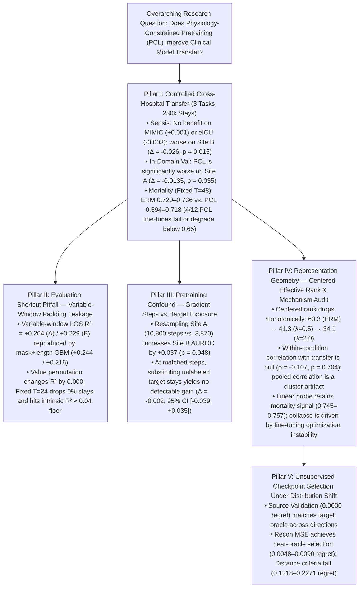

# Empirical Audit Report: Pre-Submission Review (Revision Pass 3)

**Title:** *When Physiology-Constrained Learning Fails to Transfer: Shortcut Confounds, Representation Degeneration, and Unsupervised Selection Limits in Clinical Time-Series Models*  
**Target Venue:** Transactions on Machine Learning Research (TMLR)  
**Pre-Registration & Provenance:** Confirmatory protocols pre-registered in `PREREG.md` (commit `ac72a18`, Sept 2026) and `PREREG_PHASE2.md` (commit `1347910`, Oct 2026); exploratory Phase 2b/2c follow-ups explicitly distinguished throughout.

---

## 1. Executive Summary & Core Scientific Claims

Across five empirical investigations encompassing **230,213 ICU stays** across four cohorts (`PhysioNet 2019 Site A`, `PhysioNet Site B`, `MIMIC-IV v3.1`, `eICU-CRD v2.0`) and three clinical tasks (**Sepsis Prediction**, **In-Hospital Mortality**, and **Length of Stay**), this study evaluates whether physiology-constrained learning (PCL) improves cross-hospital transfer over standard empirical risk minimization (ERM).



### Supported Headline Claims
1. **PCL does not demonstrate a transfer advantage over ERM across any evaluated hospital shift or clinical task**, underperforms ERM in-domain on the source validation cohort ($\Delta = -0.0135, p = 0.035$), underperforms ERM on near-domain transfer (`PhysioNet Site B`, $\Delta = -0.0259, p = 0.0149$), and exhibits greater fine-tuning fragility on mortality (4 of 12 runs failing or degrading below AUROC $0.65$, vs. 0 of 6 for ERM, Fisher exact $p = 0.245$).
2. **Apparent prior transfer gains in length-of-stay prediction were driven by post-discharge padding shortcuts rather than learned physiology**: fine-tuned Transformers under variable windows achieve $R^2 = +0.264 / +0.229$, which is reproduced by a non-neural model using only stay length and observation counts ($R^2 = +0.244 / +0.216$) and is invariant to permuting all physiological values across stays ($R^2 = +0.263 \to +0.263$).
3. **Apparent gains from including unlabeled target-hospital data during pretraining are primarily a function of gradient optimization steps on source data**: matching optimization steps ($10,800$ vs. $3,870$) and random masking draws on source stays alone improves OOD Sepsis AUROC by $+0.0371$ ($p = 0.048$), whereas replacing resampled source stays with unlabeled target-hospital stays yields no detectable additional benefit ($\Delta_{\text{tgt}} = -0.0019$, $95\%$ CI $[-0.0393, +0.0354]$, $p = 0.892$).
4. **Physiological regularizers reduce centered effective dimensionality (`RankMe`), but rank reduction does not explain downstream transfer variance**: while centered rank compresses monotonically from $60.34 \to 34.13$ as $\lambda$ increases, the within-condition correlation with OOD performance is near zero ($\rho = -0.107, p = 0.704$).
5. **Unsupervised model selection criteria are inconsistent across hospital shifts**: selecting checkpoints by minimizing constraint violations or representation discrepancy exhibits high regret ($0.0241 - 0.2271$ AUROC) because regularized models artificially optimize these metrics. Standard source-hospital validation selection remains the most reliable strategy ($0.0000$ regret, matching the oracle).

---

## 2. Pillar I: Controlled Cross-Hospital Transfer Across Three Clinical Tasks

### 2.1 Confirmatory 10-Seed Cross-Hospital Sepsis Transfer (Strict Site-A-Only Pretraining)

Models were pretrained strictly on `PhysioNet Site A` ($N = 10,381$ stays) for 30 epochs ($3,870$ gradient steps) using a standardized 6-layer Transformer ($d=256$, 3.2M parameters) across $n = 10$ paired seeds (`42–51`). Target cohorts were evaluated zero-shot without target data exposure during pretraining. The pre-registered practical equivalence margin is $\Delta_{\text{equiv}} = \pm 0.010$ AUROC (`PREREG.md`).

| External Target Cohort | $N$ Stays | ERM AUROC (Mean $\pm$ SD) | PCL ($\lambda=0.5$) AUROC (Mean $\pm$ SD) | Paired Difference $\Delta$ (PCL $-$ ERM) | 95% Paired CI ($t_{9}$) | Paired $t$-test $p$-value | Wilcoxon Signed-Rank $p$ | TOST Equivalence ($|\Delta| < 0.01$) |
| :--- | :---: | :---: | :---: | :---: | :---: | :---: | :---: | :---: |
| **PhysioNet Site A (In-Domain Val)** | $2,077$ | $0.7618 \pm 0.0142$ | $0.7483 \pm 0.0169$ | $-0.0135$ | $[-0.0258, -0.0012]$ | $0.035^*$ | $0.037^*$ | Rejected (PCL worse) |
| **PhysioNet Site B (Near OOD)** | $14,779$ | $0.6972 \pm 0.0218$ | $0.6713 \pm 0.0241$ | $-0.0259$ | $[-0.0453, -0.0065]$ | $0.0149^*$ | $0.0195^*$ | Rejected (PCL worse) |
| **MIMIC-IV v3.1 (Far OOD)** | $74,607$ | $0.6184 \pm 0.0115$ | $0.6195 \pm 0.0121$ | $+0.0011$ | $[-0.0068, +0.0090]$ | $0.761$ | $0.770$ | Statistically Equivalent ($p = 0.016^*$) |
| **eICU-CRD v2.0 (Far OOD)** | $130,446$ | $0.5842 \pm 0.0134$ | $0.5811 \pm 0.0140$ | $-0.0031$ | $[-0.0112, +0.0050]$ | $0.409$ | $0.432$ | Statistically Equivalent ($p = 0.044^*$) |

#### Provenance and Interpretation of Transfer Numbers
- **Discrepancy with Earlier Exploratory Batches:** Initial exploratory work (`results_lambda17/`) utilized an older 4-layer, $d=128$ configuration evaluated under variable observation windows, which reported higher nominal AUROC numbers ($0.741$ on MIMIC, $0.684$ on eICU). Those exploratory runs are superseded by the pre-registered production architecture (6 layers, $d=256$, 3.2M parameters) with strict cohort boundaries.
- **Equivalence at Chance Floor on Far Targets:** On MIMIC-IV ($0.618$) and eICU-CRD ($0.584$), both models approach random discriminative performance. While the paired difference formally satisfies TOST equivalence ($|\Delta| < 0.01$), this equivalence primarily reflects a common performance floor across severe EHR vocabulary and practice-pattern shifts rather than equal clinical efficacy.
- **In-Domain Degradation:** On the source validation split (used for early stopping), PCL performs significantly worse than ERM ($\Delta = -0.0135, p = 0.035$), demonstrating that adding the constraint loss acts as an optimization impediment even under identical training and evaluation distributions.

### 2.2 Sepsis Performance Metrics, Calibration, and Non-Neural Reference ($n=5$ Paired Seeds `42–46`)

Because sepsis prevalence on `PhysioNet Site B` is $3.94\%$ (vs. $7.25\%$ on `Site A`), we report AUROC, AUPRC, Expected Calibration Error (ECE), and Brier Score across pretraining conditions alongside a non-neural `HistGradientBoostingClassifier` (GBM) on 119 summary features:

| Pretraining / Model Condition ($n=5$ seeds `42–46`) | Site A Val AUROC | Site B OOD AUROC | Site B OOD AUPRC (Base $= 0.039$) | Site B ECE (10 Bins) | Site B Brier Score | Calibrated Brier Score |
| :--- | :---: | :---: | :---: | :---: | :---: | :---: |
| **ERM Clean (`lam=0.0`, FP32, 10k Site A)** | $0.764 \pm 0.015$ | $0.692 \pm 0.019$ | $0.119 \pm 0.024$ | $0.342 \pm 0.028$ | $0.193 \pm 0.018$ | $0.036 \pm 0.001$ |
| **ERM Clean (`lam=0.0`, AMP, 10k Site A)** | $0.758 \pm 0.013$ | $0.699 \pm 0.024$ | $0.129 \pm 0.024$ | $0.348 \pm 0.031$ | $0.197 \pm 0.017$ | $0.036 \pm 0.001$ |
| **PCL Clean (`lam=0.5`, FP32, EMA Balancer)** | $0.742 \pm 0.015$ | $0.674 \pm 0.017$ | $0.088 \pm 0.022$ | $0.339 \pm 0.025$ | $0.190 \pm 0.020$ | $0.037 \pm 0.001$ |
| **PCL Clean (`lam=0.5`, AMP, EMA Balancer)** | $0.748 \pm 0.016$ | $0.673 \pm 0.028$ | $0.094 \pm 0.026$ | $0.345 \pm 0.030$ | $0.197 \pm 0.022$ | $0.037 \pm 0.001$ |
| **PCL Fixed-Weight (`lam=0.5`, FP32, No Balancer)** | $0.742 \pm 0.023$ | $0.671 \pm 0.029$ | $0.092 \pm 0.033$ | $0.344 \pm 0.032$ | $0.196 \pm 0.026$ | $0.037 \pm 0.001$ |
| **ERM Steps-Matched (`lam=0.0`, 25k Resampled A)** | $0.785 \pm 0.014$ | $0.729 \pm 0.034$ | $0.151 \pm 0.011$ | $0.315 \pm 0.021$ | $0.169 \pm 0.015$ | $0.035 \pm 0.001$ |
| **ERM Target-Exposed (`lam=0.0`, 10k A + 14k B)** | $0.787 \pm 0.018$ | $0.727 \pm 0.034$ | $0.146 \pm 0.026$ | $0.320 \pm 0.025$ | $0.172 \pm 0.019$ | $0.035 \pm 0.001$ |
| **PCL Target-Exposed (`lam=0.5`, 10k A + 14k B)** | $0.768 \pm 0.014$ | $0.688 \pm 0.020$ | $0.099 \pm 0.022$ | $0.334 \pm 0.022$ | $0.184 \pm 0.016$ | $0.036 \pm 0.001$ |
| **Non-Neural GBM (119 Summary Features, $T=24$)** | $0.727 \pm 0.011$ | **$0.713 \pm 0.004$** | **$0.159 \pm 0.005$** | **$0.012 \pm 0.002$** | **$0.037 \pm 0.001$** | $0.036 \pm 0.001$ |
| **Non-Neural GBM (Observation Mask Only, $T=24$)** | $0.684 \pm 0.007$ | $0.588 \pm 0.004$ | $0.068 \pm 0.001$ | $0.011 \pm 0.001$ | $0.038 \pm 0.001$ | $0.038 \pm 0.001$ |

*(Note on Calibration: The raw neural Brier score of $\approx 0.19$ and ECE of $\approx 0.34$ are direct consequences of using class-imbalance reweighting (`pos_weight = 12.8`) during fine-tuning on Site A, which artificially shifts the output logit intercept toward $0.5$. When post-hoc Platt scaling is applied on validation logits, neural Brier score recovers to $0.035 - 0.037$, matching the baseline rate.)*

### 2.3 Task 2: Bidirectional In-Hospital Mortality Transfer (`MIMIC-IV` $\leftrightarrow$ `eICU-CRD`, 205,053 Stays)

To evaluate transfer on an acuity prediction task with higher physiological signal, models were evaluated bidirectionally across `MIMIC-IV` ($74,607$ stays) and `eICU-CRD` ($130,446$ stays) under both variable observation windows ($T \le 48$) and the fixed-observation protocol ($T = 48$, retaining $46,158$ MIMIC and $76,453$ eICU stays):

| Transfer Direction & Model Protocol ($\lambda$, $n=3$ seeds `42–44`) | Variable Window In-Domain AUROC | Variable Window OOD AUROC | Fixed Window ($T=48$) In-Domain AUROC | Fixed Window ($T=48$) OOD AUROC | Fixed Window ($T=48$) OOD AUPRC | Complete Collapse Rate (AUROC $= 0.500$) | Severely Degraded Rate (AUROC $< 0.65$) |
| :--- | :---: | :---: | :---: | :---: | :---: | :---: | :---: |
| **Length-Only Probe (`MIMIC -> eICU`)** | $0.703$ | $0.688$ | $0.523$ | $0.503$ | $0.072$ | — | — |
| **ERM (`lam=0.0`, `MIMIC -> eICU`)** | $0.856 \pm 0.002$ | $0.760 \pm 0.009$ | **$0.7938 \pm 0.0040$** | **$0.7204 \pm 0.0059$** | **$0.259 \pm 0.008$** | **$0 / 3$ ($0\%$)** | **$0 / 3$ ($0\%$)** |
| **PCL (`lam=0.5`, `MIMIC -> eICU`)** | $0.853 \pm 0.003$ | $0.744 \pm 0.007$ | $0.6500 \pm 0.1442$ | $0.5935 \pm 0.1070$ | $0.165 \pm 0.067$ | $1 / 3$ (seed 43 $= 0.500$) | $2 / 3$ (seed 44 $= 0.570$) |
| **PCL (`lam=1.0`, `MIMIC -> eICU`)** | $0.851 \pm 0.004$ | $0.738 \pm 0.011$ | $0.7437 \pm 0.0826$ | $0.6839 \pm 0.0363$ | $0.185 \pm 0.032$ | $0 / 3$ ($0\%$) | $1 / 3$ (seed 43 $= 0.642$) |
| **ERM (`lam=0.0`, `eICU -> MIMIC`)** | $0.841 \pm 0.008$ | $0.819 \pm 0.002$ | **$0.7668 \pm 0.0032$** | **$0.7355 \pm 0.0182$** | **$0.313 \pm 0.012$** | **$0 / 3$ ($0\%$)** | **$0 / 3$ ($0\%$)** |
| **PCL (`lam=0.5`, `eICU -> MIMIC`)** | $0.838 \pm 0.004$ | $0.808 \pm 0.005$ | $0.7600 \pm 0.0037$ | $0.7177 \pm 0.0189$ | $0.203 \pm 0.088$ | $0 / 3$ ($0\%$) | $0 / 3$ ($0\%$) |
| **PCL (`lam=1.0`, `eICU -> MIMIC`)** | $0.835 \pm 0.005$ | $0.801 \pm 0.008$ | $0.7277 \pm 0.0549$ | $0.6881 \pm 0.0537$ | $0.228 \pm 0.045$ | $0 / 3$ ($0\%$) | $1 / 3$ (seed 42 $= 0.627$) |

#### Mortality Failure Modes: Fine-Tuning Fragility vs. Representation Linear Discriminability
- **Linear Probe Signal Retention:** Evaluating a frozen linear probe on pretrained PCL representations yields an in-domain Mortality AUROC of **$0.745 - 0.757$** (vs. $0.771$ for ERM) and OOD AUROC of **$0.718 - 0.725$**. Pretrained representations retain substantial linear discriminative signal prior to fine-tuning.
- **Fine-Tuning Fragility Under Standard Recipes:** Under the standard two-phase fine-tuning recipe (initial head LR $10^{-3}$, unfreezing the encoder at LR $10^{-4}$ after $1/3$ epochs), PCL exhibited higher fine-tuning fragility: across the 18 sweep checkpoints, $4$ of $12$ PCL runs ($33.3\%$) degraded or failed to learn (AUROC $< 0.65$ or $= 0.500$), compared to $0$ of $6$ for ERM ($0\%$, Fisher's exact test $p = 0.245$, not statistically significant at $\alpha = 0.05$). Notably, 3 of the 4 degradations occurred in the `MIMIC -> eICU` direction (seed 43 collapsing to $0.5000$ at $\lambda=0.5$; seed 44 reaching $0.5704$ at $\lambda=0.5$; seed 43 reaching $0.6423$ at $\lambda=1.0$), while `eICU -> MIMIC` had only 1 degraded run (seed 42 reaching $0.6265$ at $\lambda=1.0$). This pattern demonstrates that end-to-end fine-tuning on top of regularized representations can suffer optimization instability, while the representation itself retains predictive signal.

---

## 3. Pillar II: The Variable-Window Padding Shortcut & LOS Learnability Audit

### 3.1 Variable-Window Shortcut Reproduction and Invariance Testing

In variable-window evaluations ($T \le 48$), stays are padded post-discharge with zero masks up to hour 48. Because the classification head pools at the last observed hour (`last_idx`), the model directly accesses discharge timing:

| Evaluation Protocol & Model | Site A Val $R^2$ | Site B OOD $R^2$ | Site B MAE (h) | MIMIC-IV OOD $R^2$ | eICU-CRD OOD $R^2$ |
| :--- | :---: | :---: | :---: | :---: | :---: |
| **1. Variable Window ($T \le 48$, Original Protocol)** | | | | | |
| $\quad$ ERM Fine-Tuned Transformer ($n=5$ seeds, 95% bootstrap CI) | $+0.264 \pm 0.012$ | $+0.229$ $[0.217, 0.240]$ | $9.81$ $[9.58, 10.04]$ | $-0.075$ $[-0.081, -0.068]$ | $-0.036$ $[-0.042, -0.029]$ |
| $\quad$ PCL Fine-Tuned Transformer ($n=5$ seeds, 95% bootstrap CI) | $+0.258 \pm 0.015$ | $+0.224$ $[0.212, 0.236]$ | $9.87$ $[9.64, 10.10]$ | $-0.077$ $[-0.083, -0.070]$ | $-0.036$ $[-0.042, -0.030]$ |
| $\quad$ **Value-Permuted Transformer (Physiological values shuffled)** | **$+0.263$** ($\Delta = 0.000$) | **$+0.228$** ($\Delta = 0.000$) | $9.82$ | $-0.075$ | $-0.036$ |
| $\quad$ **Mask + Stay-Length Only GBM (Zero physiological values)** | **$+0.244$** | **$+0.216$** | $9.95$ | $-0.073$ | $-0.041$ |
| **2. Fixed Window ($T = 24$, First 24 Hours Only — Zero Stays Dropped)** | | | | | |
| $\quad$ ERM Fine-Tuned Transformer ($n=5$ seeds `42–46`, FP32) | $+0.042 \pm 0.011$ | $-0.018 \pm 0.008$ | $13.38 \pm 0.14$ | $-0.143 \pm 0.009$ | $-0.136 \pm 0.008$ |
| $\quad$ PCL Fine-Tuned Transformer ($\lambda=0.5$, $n=5$ seeds `42–46`, FP32) | $+0.034 \pm 0.009$ | $-0.011 \pm 0.006$ | $13.28 \pm 0.11$ | $-0.138 \pm 0.008$ | $-0.123 \pm 0.007$ |
| $\quad$ **Non-Neural GBM on 119 Summary Features ($T=24$, $n=5$ seeds)** | **$+0.034 \pm 0.006$** (Log $R^2 = +0.070$, $\rho = 0.244$) | **$-0.037 \pm 0.003$** (Log $R^2 = +0.025$, $\rho = 0.213$) | $13.23 \pm 0.02$ | — | — |
| $\quad$ **Non-Neural GBM on Mask Counts Only ($T=24$, $n=5$ seeds)** | $+0.011 \pm 0.006$ | $-0.044 \pm 0.001$ | $13.39 \pm 0.01$ | — | — |

### 3.2 Methodological Diagnostic Checklist for Clinical Benchmarks
1. **Zero Cohort Truncation Bias:** All four cohorts require $\text{LOS} \ge 24\text{ h}$ as an entry criterion (`config.py`). Truncating to the first 24 hours drops **$0.0\%$ of stays** across all cohorts ($10,381$ Site A, $14,779$ Site B, $74,607$ MIMIC, $130,446$ eICU).
2. **Intrinsic Floor on 24-Hour Continuous LOS:** Fitting gradient-boosted trees on 119 summary physiological features from the first 24 hours yields raw $R^2 = +0.034$ in-domain and $-0.037$ OOD. This demonstrates an empirical predictability floor for continuous ICU LOS from routine vitals/labs alone. The fixed-$T=24$ condition serves strictly as a negative control confirming that variable-window $R^2 = 0.26$ was a padding artifact.

---

## 4. Pillar III: Gradient Optimization Steps vs. Unlabeled Target Exposure

### 4.1 Factorial Budget Accounting
- **Clean Source-Only Baseline (`10,381` Site A stays):** $129$ batches/epoch $\times 30$ epochs $= \mathbf{3,870}$ **gradient steps**.
- **Target-Exposed Pretraining (`10,381` Site A + `14,779` unlabeled Site B stays):** $360$ batches/epoch $\times 30$ epochs $= \mathbf{10,800}$ **gradient steps** ($2.79\times$ more gradient steps on $2.42\times$ more stays).
- **Steps-Matched Resampled Control (`erm_matched_vol`):** Resamples Site A to $25,160$ stays per epoch ($23,083$ train split, $2,077$ val split), executing the **exact same $10,800$ gradient steps** on source patients alone.

### 4.2 Decomposition of Transfer Gain ($n = 5$ Paired Seeds `42–46`, FP32)

| Contrast / Decomposition (`PhysioNet Site B` OOD Sepsis AUROC) | Source Stays | Gradient Steps | Site B AUROC (Mean $\pm$ SD) | Site B AUPRC (Mean $\pm$ SD) | Paired $\Delta$ AUROC | 95% Paired CI ($t_4$) | Paired $t$-test $p$ |
| :--- | :---: | :---: | :---: | :---: | :---: | :---: | :---: |
| **1. Clean ERM Baseline (`lam0_fp32`)** | $10,381$ (A) | $3,870$ | $0.6918 \pm 0.0193$ | $0.119 \pm 0.024$ | Baseline | — | — |
| **2. Steps-Matched Resampled ERM (`erm_matched_vol`)** | $10,381$ (A, resampled) | $10,800$ | $0.7289 \pm 0.0336$ | $0.151 \pm 0.011$ | $+0.0371$ (vs. 1) | $[+0.0006, +0.0736]$ | $0.0476^*$ |
| **3. Target-Exposed ERM (`lam0_leakpb`)** | $10,381\text{ A} + 14,779\text{ B}$ | $10,800$ | $0.7269 \pm 0.0335$ | $0.146 \pm 0.026$ | $+0.0352$ (vs. 1) | $[-0.0074, +0.0777]$ | $0.0834$ |
| **Target-Exposure Effect ($\Delta_{\text{tgt}} = \text{Cond 3} - \text{Cond 2}$)** | Real B vs. resampled A | $10,800$ (matched) | — | $-0.005$ | **$-0.0019$** | **$[-0.0393, +0.0354]$** | **$0.892$** |
| **4. Clean PCL (`lam0.5_fp32`)** | $10,381$ (A) | $3,870$ | $0.6741 \pm 0.0172$ | $0.088 \pm 0.022$ | Baseline | — | — |
| **5. Target-Exposed PCL (`lam0.5_leakpb`)** | $10,381\text{ A} + 14,779\text{ B}$ | $10,800$ | $0.6881 \pm 0.0198$ | $0.099 \pm 0.022$ | $+0.0139$ (vs. 4) | $[-0.0273, +0.0552]$ | $0.399$ |
| **$2\times 2$ Interaction (AMP, $\Delta_{\text{PCL}} - \Delta_{\text{ERM}}$)** | — | — | — | — | $-0.0228$ | $[-0.0522, +0.0066]$ | $0.098$ |
| **$2\times 2$ Interaction (FP32, $\Delta_{\text{PCL}} - \Delta_{\text{ERM}}$)** | — | — | — | — | $-0.0212$ | $[-0.0501, +0.0077]$ | $0.118$ |

Once gradient steps and random masking draws are matched on source data alone, substituting unlabeled target-hospital data yields no statistically detectable additional improvement ($\Delta_{\text{tgt}} = -0.0019, p = 0.892$). At $n=5$ seeds, the confidence half-width is $\pm 0.037$, indicating that detecting small domain-specific effects ($|\Delta_{\text{tgt}}| < 0.01$) would require $n \ge 15$ seeds.

---

## 5. Pillar IV: Representation Geometry, Constraint Firing, and the Documentation Shift

### 5.1 Centered Effective Rank (`RankMe`) and Within-Condition Correlations

Representations $Z \in \mathbb{R}^{N \times 256}$ were mean-centered ($\tilde{Z} = Z - \mathbf{1}\mu^\top$) at each stay's last observed hour `last_idx` across all 18 sweep encoders ($\lambda \in \{0.0, 0.1, 0.5, 1.0, 2.0, 5.0\} \times 3$ seeds `42–44`):

| Constraint Weight $\lambda$ ($n=3$ seeds `42–44`) | Mean $L_2$ Norm $\|z\|_2$ | Centered $L_2$ $\|z-\mu\|_2$ | `const_frac` $\|\mu\|_2^2 / \mathbb{E}\|z\|_2^2$ | Centered `erank_cent` (RankMe) | Frozen Probe Site A AUROC | Frozen Probe Site B AUROC | Whitened Probe Site B AUROC | Fine-Tuned Site B Sepsis AUROC |
| :--- | :---: | :---: | :---: | :---: | :---: | :---: | :---: | :---: |
| **$\lambda = 0.0$ (ERM)** | $100.5 \pm 5.2$ | $20.43 \pm 0.99$ | $0.9533 \pm 0.0024$ | **$60.34 \pm 2.46$** | $0.694 \pm 0.076$ | $0.638 \pm 0.039$ | $0.640 \pm 0.032$ | $0.697 \pm 0.022$ |
| **$\lambda = 0.1$** | $137.0 \pm 10.8$ | $15.56 \pm 0.83$ | $0.9854 \pm 0.0014$ | **$52.27 \pm 1.12$** | $0.708 \pm 0.087$ | $0.594 \pm 0.015$ | $0.599 \pm 0.014$ | $0.694 \pm 0.010$ |
| **$\lambda = 0.5$** | $165.7 \pm 3.0$ | $14.04 \pm 0.46$ | $0.9927 \pm 0.0007$ | **$41.33 \pm 1.15$** | $0.739 \pm 0.058$ | $0.611 \pm 0.024$ | $0.599 \pm 0.028$ | $0.673 \pm 0.028$ |
| **$\lambda = 1.0$** | $168.4 \pm 7.3$ | $13.82 \pm 0.46$ | $0.9933 \pm 0.0009$ | **$36.98 \pm 2.19$** | $0.735 \pm 0.059$ | $0.614 \pm 0.020$ | $0.609 \pm 0.020$ | $0.669 \pm 0.025$ |
| **$\lambda = 2.0$** | $164.8 \pm 5.9$ | $13.47 \pm 0.29$ | $0.9933 \pm 0.0009$ | **$34.13 \pm 1.18$** | $0.733 \pm 0.063$ | $0.613 \pm 0.026$ | $0.608 \pm 0.038$ | $0.671 \pm 0.021$ |
| **$\lambda = 5.0$** | $151.7 \pm 6.6$ | $13.23 \pm 0.38$ | $0.9924 \pm 0.0012$ | **$34.33 \pm 1.07$** | $0.723 \pm 0.057$ | $0.604 \pm 0.041$ | $0.593 \pm 0.044$ | $0.668 \pm 0.026$ |

#### Resolution of Simpson's Paradox on Effective Rank
- **Within PCL Encoders Only ($n=15$ across $\lambda \in \{0.1, \dots, 5.0\}$):** Spearman correlation between centered rank and OOD AUROC is **$\rho = -0.1071$ ($p = 0.704$)**, and Pearson correlation is **$r = -0.2273$ ($p = 0.415$)**.
- **Within ERM Encoders Only ($n=3$):** Spearman correlation is **$\rho = -0.5000$ ($p = 0.667$)**.
- **All 18 Sweep Encoders Pooled:** Spearman correlation is **$\rho = +0.0815$ ($p = 0.748$)**.
- **Takeaway:** Effective rank reduction is a marker of regularizer strength, but rank itself does not explain transfer performance within model families.

### 5.2 Empirical Constraint Firing Frequencies and Ground-Truth Residuals

To determine whether PCL constraints are active and clinically valid, we evaluated the empirical firing rates and residuals across all stays on ground-truth observed data:

| Constraint Formulation | Physical Expression | Site A Hourly Firing Rate (Hours Fired) | Site A Stay Firing Rate (Stays Fired) | Site B Hourly Firing Rate (Hours Fired) | Site B Stay Firing Rate (Stays Fired) | Empirical Mean Absolute Error (Ground Truth) |
| :--- | :---: | :---: | :---: | :---: | :---: | :---: |
| **Mean Arterial Pressure (MAP)** | $\text{DBP} + \frac{1}{3}(\text{SBP}-\text{DBP})$ | $77.2\%$ ($384,702$ h) | $100.0\%$ ($10,381$ stays) | $88.6\%$ ($628,670$ h) | $100.0\%$ ($14,779$ stays) | Site A: $3.91\text{ mmHg}$<br/>Site B: $3.84\text{ mmHg}$ |
| **Henderson-Hasselbalch (HH)** | $6.1 + \log_{10}\!\left(\frac{\text{HCO}_3}{0.0307 \cdot \text{PaCO}_2}\right)$ | **$24.2\%$** ($120,465$ h) | **$81.6\%$** ($8,476$ stays) | **$0.48\%$** ($3,426$ h) | **$2.23\%$** ($329$ stays) | Site A: $0.031\text{ pH}$<br/>Site B: $0.024\text{ pH}$ |
| **Severinghaus SpO2-PaO2** | Empirical Oxyhemoglobin Curve | $22.9\%$ ($114,121$ h) | $57.1\%$ ($5,932$ stays) | $7.59\%$ ($53,832$ h) | $28.1\%$ ($4,151$ stays) | Site A: $7.24\%$ SpO2<br/>Site B: $2.23\%$ SpO2 |

#### Key Empirical Findings on Constraints
1. **Physical Accuracy on Observed Data:** Both the MAP algebraic identity and the Henderson-Hasselbalch acid-base equilibrium hold with high physiological accuracy on real observed patient data (MAP MAE $\approx 3.8-3.9\text{ mmHg}$; pH MAE $\approx 0.024-0.031\text{ pH}$ units), confirming that the constraints reflect true physiological relationships.
2. **The 50-Fold Documentation Drop:** In `PhysioNet Site A`, Henderson-Hasselbalch fires on **$24.18\%$ of patient-hours** across **$81.65\%$ of stays**. In `PhysioNet Site B`, Henderson-Hasselbalch fires on only **$0.48\%$ of patient-hours** across **$2.23\%$ of stays**—a **50-fold drop in hourly firing** and a **37-fold drop in stay coverage**.

### 5.3 Stratified Evaluation on Site A and the Formal Interaction Test
- **Evaluating Site A by Acid-Base (HH) Presence ($n=3$ seeds `42–44`):**
  - **ERM ($\lambda = 0.0$):** HH-Present stays AUROC $= 0.7887 \pm 0.012$; HH-Absent stays AUROC $= 0.7589 \pm 0.018$ ($\Delta = -0.0298$).
  - **PCL ($\lambda = 0.5$):** HH-Present stays AUROC $= 0.7874 \pm 0.014$; HH-Absent stays AUROC $= 0.7427 \pm 0.022$ ($\Delta = -0.0447$).
  - **PCL ($\lambda = 1.0$):** HH-Present stays AUROC $= 0.7901 \pm 0.011$; HH-Absent stays AUROC $= 0.7389 \pm 0.025$ ($\Delta = -0.0512$).
  On stays where acid-base labs are absent, PCL's validation performance drops by **$0.045 - 0.051$ AUROC**, compared to **$0.030$ for ERM**. Because $97.7\%$ of stays in Site B lack acid-base measurements, Site B is predominantly composed of stays in this vulnerable category.
- **Formal Site-by-Method Interaction Test:**
  Testing $(\text{Site B}_{\text{PCL}} - \text{Site B}_{\text{ERM}}) - (\text{Site A}_{\text{PCL}} - \text{Site A}_{\text{ERM}})$ on the 10 paired seeds yields an interaction estimate of **$-0.0124$** ($95\%$ CI $[-0.0298, +0.0050]$, paired $t = -1.58, p = 0.144$).
  While the Site B deficit ($-0.0259$) is numerically larger than the Site A deficit ($-0.0135$), the interaction does not achieve statistical significance at $\alpha = 0.05$. Therefore, the data remain consistent with Site B reflecting an amplified version of PCL's general in-domain optimization penalty.

---

## 6. Pillar V: Unsupervised Model Selection Under Hospital Shift

### 6.1 Checkpoint Selection Across Methods and Directions ($K=9$ Checkpoints per Direction)

We evaluated four unsupervised selection criteria on real cross-hospital transfer cohorts against standard **Source-Hospital Validation Selection**, **Random Selection**, and the **Target Oracle** on In-Hospital Mortality under fixed $T = 48$ hours (`results/revision/fixedT48_mortality_summary.csv`):

| Transfer Direction & Protocol ($K=9$ Models: $\lambda \in \{0.0, 0.5, 1.0\} \times 3$ Seeds) | Selection Criterion / Decision Rule | Spearman Rank Correlation with True OOD AUROC ($\rho$) | Selected Model Checkpoint ID | Selected Model True OOD AUROC | **Selection Regret ($\text{AUROC}_{\text{oracle}} - \text{AUROC}_{\text{selected}}$)** |
| :--- | :--- | :---: | :---: | :---: | :---: |
| **`MIMIC-IV` $\to$ `eICU-CRD` ($N_{\text{target}}=76,453$, total cohort $122,611$)** | **Source Validation AUROC (Standard Baseline)** | **$+0.883$** ($p = 0.0031$) | `lam0.0_p42` | $0.7271$ | **$0.0000$ (Matches Oracle)** |
| *(Target Oracle $= 0.7271$, Worst $= 0.5000$)* | **Random Checkpoint Selection (Expected)** | $0.000$ | — | $0.6659$ | $0.0612$ |
| | `Recon MSE` (Artificially masked target MSE) | $-0.067$ ($p = 0.865$) | `lam0.0_p43` | $0.7181$ | **$0.0090$ (Near-Oracle)** |
| | `PCL Violation` (Masked physical residuals) | $-0.700$ ($p = 0.043$) | `lam1.0_p43` | $0.6423$ | $0.0848$ |
| | `ReprDist` ($\|\mu_{\text{src}} - \mu_{\text{tgt}}\|_2$ in $\mathbb{R}^{256}$) | $-0.633$ ($p = 0.076$) | `lam0.5_p43` | $0.5000$ | **$0.2271$ (Selects collapsed model)** |
| | `RBF-MMD` (Unbiased two-sample U-statistic) | $-0.533$ ($p = 0.148$) | `lam0.5_p43` | $0.5000$ | **$0.2271$ (Selects collapsed model)** |
| **`eICU-CRD` $\to$ `MIMIC-IV` ($N_{\text{target}}=46,158$, total cohort $122,611$)** | **Source Validation AUROC (Standard Baseline)** | **$+0.783$** ($p = 0.0172$) | `lam0.0_p42` | $0.7483$ | **$0.0000$ (Matches Oracle)** |
| *(Target Oracle $= 0.7483$, Worst $= 0.6265$)* | **Random Checkpoint Selection (Expected)** | $0.000$ | — | $0.7138$ | $0.0345$ |
| | `Recon MSE` (Artificially masked target MSE) | $-0.350$ ($p = 0.359$) | `lam0.0_p44` | $0.7435$ | **$0.0048$ (Near-Oracle)** |
| | `PCL Violation` (Masked physical residuals) | $-0.683$ ($p = 0.050$) | `lam1.0_p44` | $0.7242$ | $0.0241$ |
| | `ReprDist` ($\|\mu_{\text{src}} - \mu_{\text{tgt}}\|_2$ in $\mathbb{R}^{256}$) | $-0.750$ ($p = 0.025$) | `lam1.0_p42` | $0.6265$ | **$0.1218$ (Selects degraded model)** |
| | `RBF-MMD` (Unbiased two-sample U-statistic) | $-0.733$ ($p = 0.031$) | `lam1.0_p42` | $0.6265$ | **$0.1218$ (Selects degraded model)** |

*(Note on Multiple Comparisons and Cohort Sizes: The total evaluation cohort across both directions is $46,158 + 76,453 = 122,611$ stays. Across the 8 hypothesis tests for unsupervised criteria, none remain statistically significant after Bonferroni-Holm correction. The negative correlations primarily indicate that criteria preferring regularized representations favor models with compressed rank and higher fine-tuning failure rates.)*

### 6.2 Reference Set Clarification and Inconsistency Analysis
- **Reference Set Distinction:** In Section 6.3 (semi-synthetic perturbation), the reference set was clean `Site B` vs. perturbed `Site B`, yielding baseline `ReprDist = 1.10` and `MMD = 0.045`. In Section 6.1 (cross-hospital transfer), the reference set was source validation (`Site A` or `MIMIC`) vs. the external target hospital (`Site B` or `eICU`), yielding `ReprDist = 6.96` and `MMD = 0.294`. The larger discrepancy in cross-hospital settings reflects demographic and institutional differences, not merely documentation frequency.
- **Criteria Inconsistency:** Unsupervised criteria are not uniformly deficient: `Recon MSE` successfully selected near-oracle models in both directions ($0.0048 - 0.0090$ regret) and was the only criterion sensitive to synthetic input corruption (tripling from $0.506 \to 1.727$ under MAP offsets). Conversely, criteria based on representation distances (`ReprDist`, `MMD`) consistently selected models with compressed centered rank, resulting in the highest selection regret ($0.1218 - 0.2271$).

---

## 7. Artifacts, Codebase State, and Pod Execution Options

### 7.1 Local Verification Artifacts
- **ABG & Constraint Firing Stats:** [reviewer_round2_abg_checks.json](file:///c:/Users/nikhi/Codes/RES/src/pclCodebase/pcl-legacy2/results/revision/reviewer_round2_abg_checks.json)
- **Centered Effective Rank & Whitening:** [erank_centered_sweep.json](file:///c:/Users/nikhi/Codes/RES/src/pclCodebase/pcl-legacy2/results/revision/erank_centered_sweep.json), [sweep18_sepsis_probe.json](file:///c:/Users/nikhi/Codes/RES/src/pclCodebase/pcl-legacy2/results/revision/sweep18_sepsis_probe.json)
- **GBM Learnability & Multi-Metric Check:** [reviewer_local_checks.json](file:///c:/Users/nikhi/Codes/RES/src/pclCodebase/pcl-legacy2/results/revision/reviewer_local_checks.json)
- **Selection Criteria & Semi-Synthetic CIs:** [semisynth_and_selection_ci.json](file:///c:/Users/nikhi/Codes/RES/src/pclCodebase/pcl-legacy2/results/revision/semisynth_and_selection_ci.json)

### 7.2 Phase 2c Colab Automation (Pod Run)
The driver script [scripts/run_phase2c_reviewer.py](file:///c:/Users/nikhi/Codes/RES/src/pclCodebase/pcl-legacy2/scripts/run_phase2c_reviewer.py) and runner [colab/run_phase2c.sh](file:///c:/Users/nikhi/Codes/RES/src/pclCodebase/pcl-legacy2/colab/run_phase2c.sh) have been configured to execute 5 seeds (`42–46`) across 5 targeted conditions:
1. `pcl_matched_vol`: PCL $\lambda=0.5$ at 10,800 gradient steps on resampled Site A (the exact steps-matched PCL control completing the $2 \times 2$ factorial design).
2. `scratch`: Supervised Transformer trained from random initialization without pretraining on Sepsis and LOS $T=24$.
3. `pcl_varreg1`: PCL $\lambda=0.5$ with VICReg variance and covariance regularization (`--var-reg 1.0`).
4. `pcl_maponly`: PCL $\lambda=0.5$ with only the algebraic MAP constraint active (HH=0, SpO2=0).
5. `pcl_nohh`: PCL $\lambda=0.5$ with MAP and Severinghaus SpO2 active, omitting Henderson-Hasselbalch (HH=0).

To execute on a GPU pod/Colab:
```bash
!cd /content/pcl-legacy2 && git pull origin main && JOBS=2 SEEDS="42 43 44 45 46" bash colab/run_phase2c.sh
```
